# 全题材关卡造景素材

共 **25 张透明 PNG 图集、150 个独立场景**。本批只交付素材，未新增图鉴或接入游戏。

每张图集为 **3 列 × 2 行**，编号按左到右、上到下排列。原生尺寸和逐格像素区域见 [catalog.json](catalog.json)。图集采用统一等距微缩景观风格，保留生成原像素与透明通道。

## 素材目录

### 仙侠修仙

[xianxia-cultivation.png](atlases/xianxia-cultivation.png)

| 格 | 场景名 | 对应题材 |
| --- | --- | --- |
| 01 | 问道山门 | 修真 |
| 02 | 瀑下仙阙 | 古典仙侠 |
| 03 | 青禾药圃 | 凡人修仙 |
| 04 | 万剑孤峰 | 剑修 |
| 05 | 灵泉梯田 | 种田修仙 |
| 06 | 霓城隐观 | 现代修仙/都市修仙 |

### 科幻未来

[scifi-frontiers.png](atlases/scifi-frontiers.png)

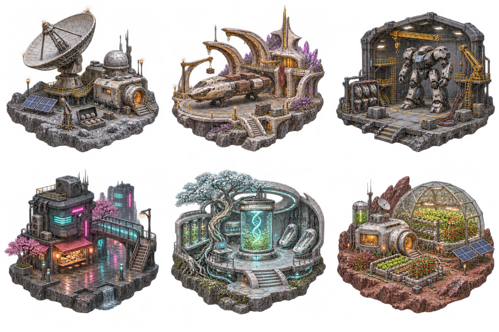

| 格 | 场景名 | 对应题材 |
| --- | --- | --- |
| 01 | 月面观测站 | 硬科幻 |
| 02 | 星港远航 | 星际/太空歌剧 |
| 03 | 重装机库 | 机甲 |
| 04 | 霓虹街区 | 赛博朋克 |
| 05 | 进化实验室 | 基因/机械飞升 |
| 06 | 红星温室 | 星际种田 |

### 末世求生

[apocalypse-survival.png](atlases/apocalypse-survival.png)

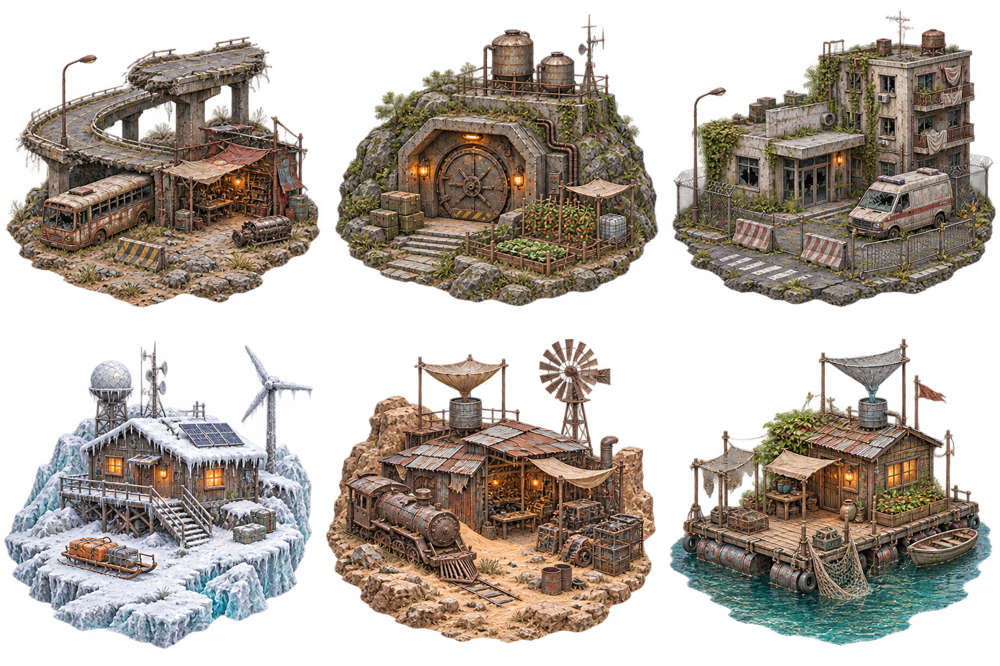

| 格 | 场景名 | 对应题材 |
| --- | --- | --- |
| 01 | 断桥余烬 | 末世废土 |
| 02 | 深岩避难所 | 末日求生 |
| 03 | 隔离街区 | 末日封锁 |
| 04 | 冰原前哨 | 冰封末日 |
| 05 | 沙海车间 | 废土回收 |
| 06 | 浮海营地 | 海洋求生 |

### 悬疑民俗

[mystery-folklore.png](atlases/mystery-folklore.png)

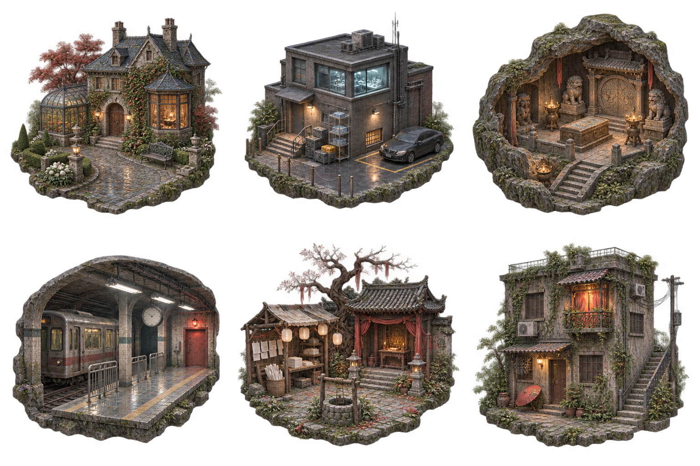

| 格 | 场景名 | 对应题材 |
| --- | --- | --- |
| 01 | 雾宅疑云 | 推理探案 |
| 02 | 夜班警署 | 刑侦 |
| 03 | 幽陵石门 | 盗墓探险 |
| 04 | 末班站台 | 规则怪谈 |
| 05 | 纸灯古祠 | 中式民俗恐怖 |
| 06 | 红伞旧楼 | 都市异闻 |

### 奇幻哥特

[cosmic-gothic.png](atlases/cosmic-gothic.png)

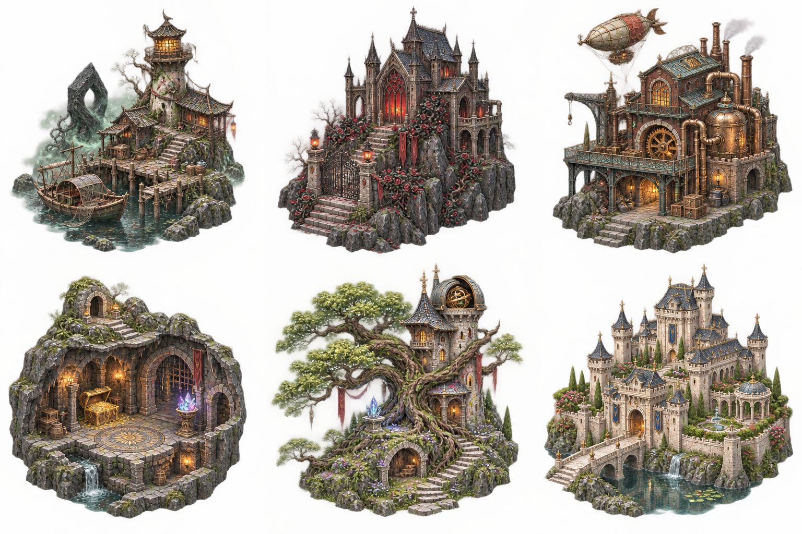

| 格 | 场景名 | 对应题材 |
| --- | --- | --- |
| 01 | 异潮海港 | 克苏鲁/克系 |
| 02 | 绯月古堡 | 血族 |
| 03 | 齿轮工坊 | 蒸汽朋克 |
| 04 | 地城秘藏 | DND/伪DND |
| 05 | 古木星塔 | 巫师流 |
| 06 | 白石王都 | 西幻剑与魔法/史诗奇幻 |

### 诸天无限

[world-hopping.png](atlases/world-hopping.png)

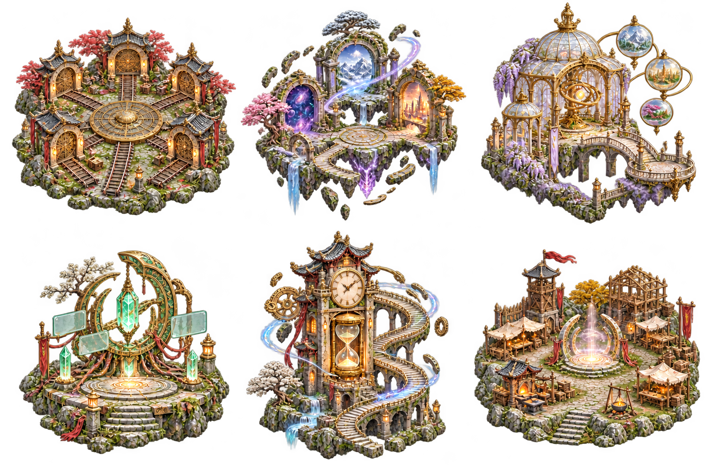

| 格 | 场景名 | 对应题材 |
| --- | --- | --- |
| 01 | 轮回中转站 | 无限流 |
| 02 | 万界石门 | 诸天流 |
| 03 | 时序驿站 | 快穿 |
| 04 | 契约终端 | 系统流 |
| 05 | 溯时钟楼 | 读档流 |
| 06 | 重生营地 | 第四天灾流 |

### 洪荒神话

[mythic-primordial.png](atlases/mythic-primordial.png)

| 格 | 场景名 | 对应题材 |
| --- | --- | --- |
| 01 | 太初神木 | 洪荒 |
| 02 | 镇岳武院 | 高武 |
| 03 | 觉醒旧城 | 灵气复苏 |
| 04 | 云台封神 | 封神衍生 |
| 05 | 灵山古渡 | 西游衍生 |
| 06 | 龙骨祭坛 | 神话 |

### 玄幻异世

[eastern-fantasy.png](atlases/eastern-fantasy.png)

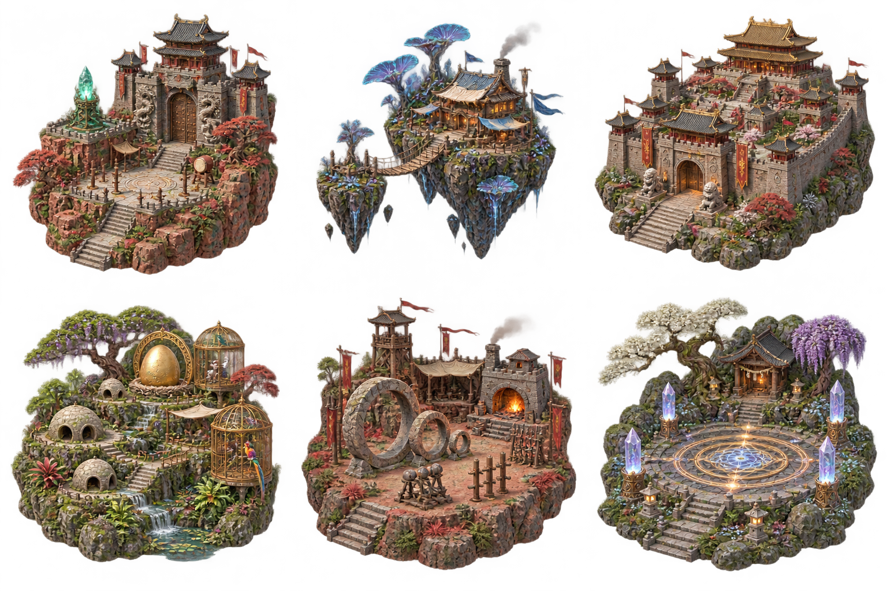

| 格 | 场景名 | 对应题材 |
| --- | --- | --- |
| 01 | 赤霄古城 | 东方玄幻 |
| 02 | 浮陆驿站 | 异世大陆 |
| 03 | 九旗王城 | 王朝争霸 |
| 04 | 万灵兽苑 | 御兽 |
| 05 | 赤炉演武场 | 气血武道 |
| 06 | 星阵召唤台 | 召唤流 |

### 武侠江湖

[wuxia-jianghu.png](atlases/wuxia-jianghu.png)

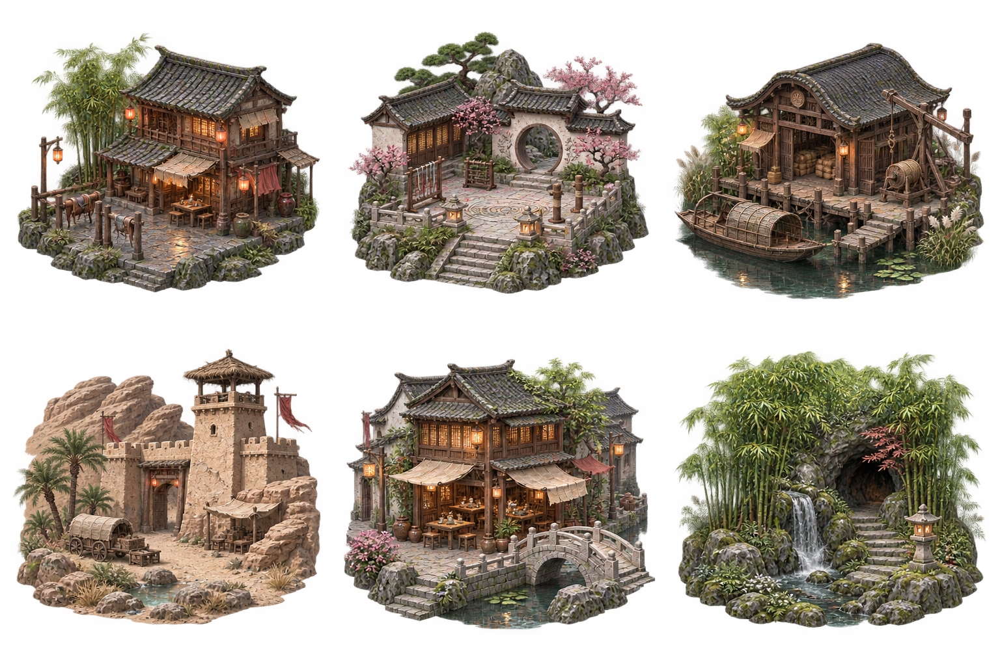

| 格 | 场景名 | 对应题材 |
| --- | --- | --- |
| 01 | 风雨客栈 | 传统武侠 |
| 02 | 青崖剑庄 | 门派江湖 |
| 03 | 烟雨漕帮 | 江湖水路 |
| 04 | 大漠孤关 | 边塞武侠 |
| 05 | 长街茶肆 | 市井武侠 |
| 06 | 竹影秘窟 | 江湖秘境 |

### 都市生活

[urban-life.png](atlases/urban-life.png)

| 格 | 场景名 | 对应题材 |
| --- | --- | --- |
| 01 | 梧桐街角 | 都市生活 |
| 02 | 云端创投 | 商战创业 |
| 03 | 深夜写字楼 | 职场 |
| 04 | 星幕片场 | 娱乐圈/华娱 |
| 05 | 晴窗书院 | 校园 |
| 06 | 烟火食坊 | 美食 |

### 都市异能

[urban-extraordinary.png](atlases/urban-extraordinary.png)

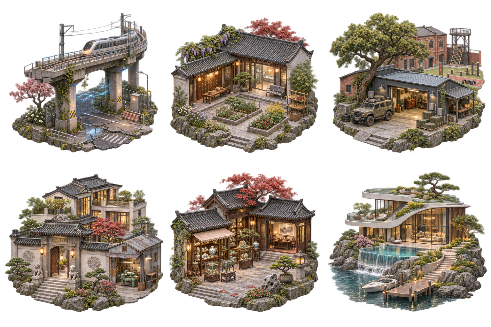

| 格 | 场景名 | 对应题材 |
| --- | --- | --- |
| 01 | 雨夜觉醒 | 都市异能 |
| 02 | 杏林医馆 | 神医 |
| 03 | 归城旧营 | 兵王/战神 |
| 04 | 庭深旧宅 | 赘婿 |
| 05 | 藏珍古玩街 | 鉴宝 |
| 06 | 海湾云邸 | 神豪 |

### 现实年代

[reality-era.png](atlases/reality-era.png)

| 格 | 场景名 | 对应题材 |
| --- | --- | --- |
| 01 | 人间小院 | 现实 |
| 02 | 旧厂新灯 | 年代文 |
| 03 | 稻香村落 | 乡土种田 |
| 04 | 寒窗小铺 | 布衣逆袭 |
| 05 | 留声书屋 | 文抄/文娱流 |
| 06 | 雨停以后 | 短篇 |

### 历史王朝

[history-courts.png](atlases/history-courts.png)

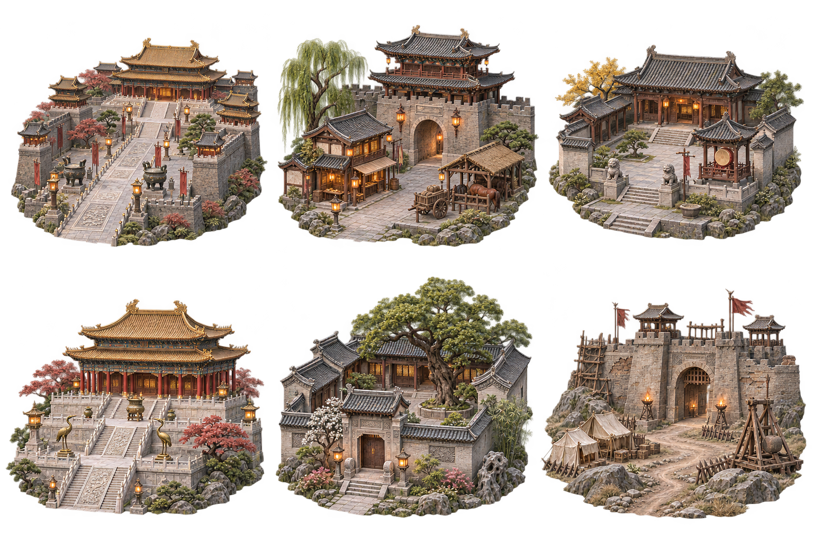

| 格 | 场景名 | 对应题材 |
| --- | --- | --- |
| 01 | 青铜王都 | 架空历史 |
| 02 | 驿路长安 | 穿越历史 |
| 03 | 古城县衙 | 考据正史 |
| 04 | 金阶议政 | 朝堂权谋 |
| 05 | 百年祠堂 | 世家宗族 |
| 06 | 烽火孤城 | 乱世争霸 |

### 军事谍战

[military-operations.png](atlases/military-operations.png)

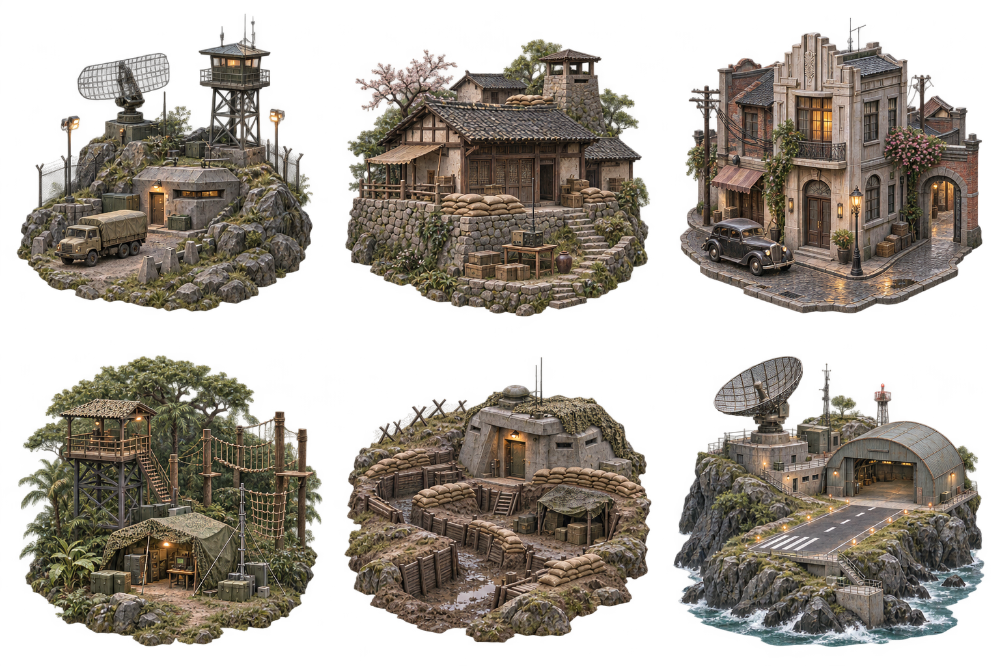

| 格 | 场景名 | 对应题材 |
| --- | --- | --- |
| 01 | 边防哨所 | 军事 |
| 02 | 山城战地 | 抗战 |
| 03 | 暗巷电台 | 谍战 |
| 04 | 雨林前哨 | 特种兵 |
| 05 | 壕沟要塞 | 战争战略 |
| 06 | 海岬雷达站 | 海空军事 |

### 古代言情

[ancient-romance.png](atlases/ancient-romance.png)

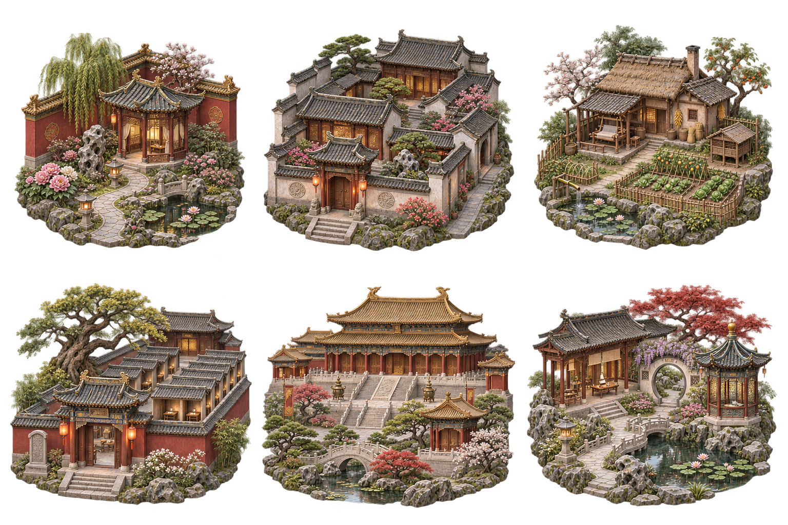

| 格 | 场景名 | 对应题材 |
| --- | --- | --- |
| 01 | 朱墙深宫 | 宫斗 |
| 02 | 海棠重院 | 宅斗 |
| 03 | 南亩春耕 | 种田 |
| 04 | 灯下贡院 | 科举 |
| 05 | 凤仪王庭 | 女尊 |
| 06 | 三朝园记 | 朝代穿/清穿/唐穿/明穿 |

### 现代言情

[modern-romance.png](atlases/modern-romance.png)

| 格 | 场景名 | 对应题材 |
| --- | --- | --- |
| 01 | 云际会客厅 | 总裁/霸道总裁流 |
| 02 | 蔷薇家宴 | 豪门恩怨 |
| 03 | 月下公馆 | 民国 |
| 04 | 双窗公寓 | 现代都市纯爱 |
| 05 | 橘灯新居 | 甜宠/先婚后爱 |
| 06 | 旧站重逢 | 破镜重圆/追妻火葬场 |

### 幻想言情

[fantasy-romance.png](atlases/fantasy-romance.png)

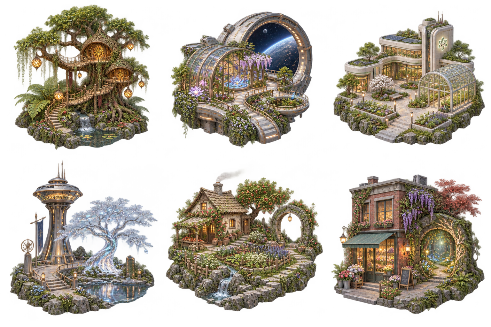

| 格 | 场景名 | 对应题材 |
| --- | --- | --- |
| 01 | 林冠栖居 | 兽世 |
| 02 | 星环花园 | 星际言情 |
| 03 | 白榆疗养院 | ABO |
| 04 | 精神图景哨塔 | 哨向 |
| 05 | 方寸灵园 | 随身空间 |
| 06 | 夜城花隙 | 幻想现言/奇幻言情/现代幻想纯爱 |

### 游戏体育

[game-sports.png](atlases/game-sports.png)

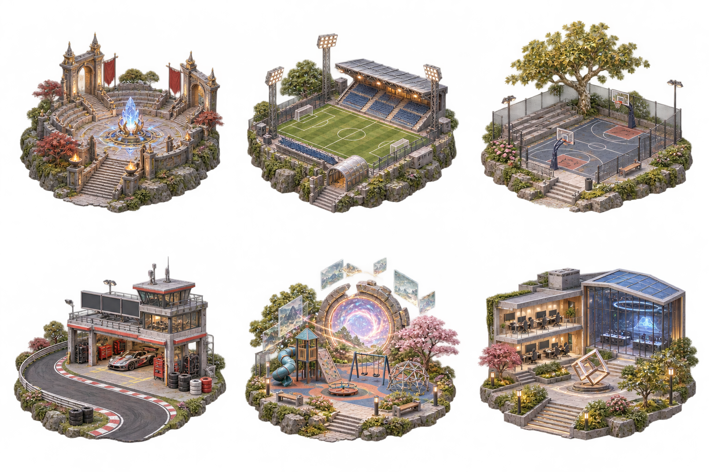

| 格 | 场景名 | 对应题材 |
| --- | --- | --- |
| 01 | 水晶竞技场 | 游戏/游戏竞技 |
| 02 | 绿茵球场 | 体育/足球 |
| 03 | 街角篮场 | 体育/篮球 |
| 04 | 极速维修站 | 体育/赛车 |
| 05 | 像素裂隙 | 游戏现实融合流 |
| 06 | 竞技训练基地 | 第四天灾/电竞 |

### 青春轻小说

[youth-anime.png](atlases/youth-anime.png)

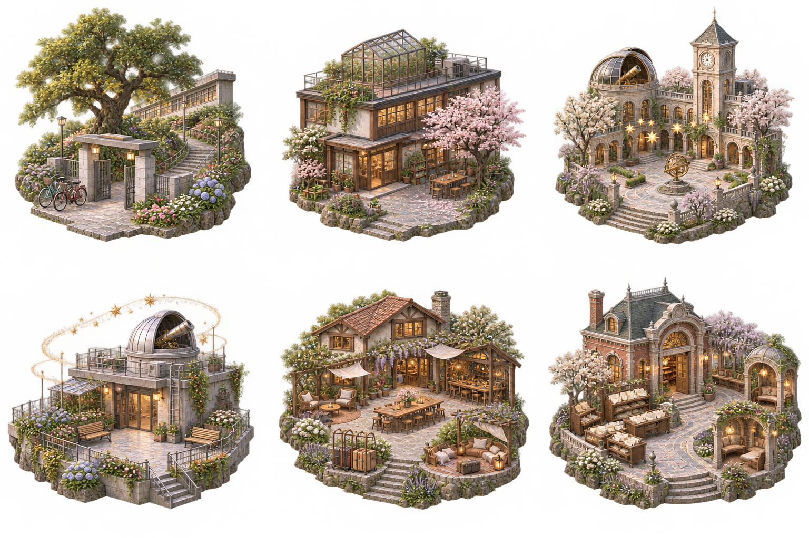

| 格 | 场景名 | 对应题材 |
| --- | --- | --- |
| 01 | 放学坡道 | 浪漫青春/青梅竹马 |
| 02 | 晴空社团楼 | 轻小说 |
| 03 | 星愿钟庭 | 二次元言情 |
| 04 | 暮色天台 | 现代幻想 |
| 05 | 群星旅舍 | 无CP/群像 |
| 06 | 回声邮局 | 互动小说/论坛体/对话体 |

### 经营建设

[management-realms.png](atlases/management-realms.png)

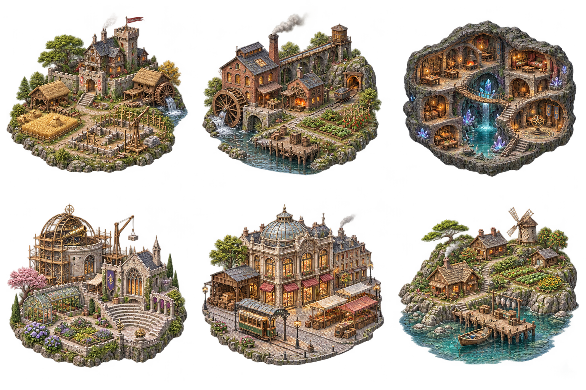

| 格 | 场景名 | 对应题材 |
| --- | --- | --- |
| 01 | 边疆领主庄园 | 领主经营 |
| 02 | 河谷工坊 | 工业种田 |
| 03 | 迷宫工匠城 | 地下城经营 |
| 04 | 初创魔法学园 | 学院建设 |
| 05 | 百货商埠 | 商业模拟 |
| 06 | 珊瑚小镇 | 海岛经营 |

### 奇幻种族

[fantasy-peoples.png](atlases/fantasy-peoples.png)

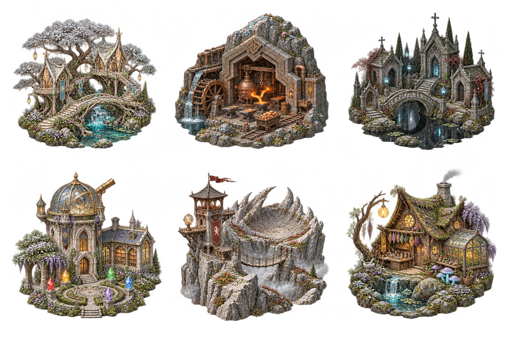

| 格 | 场景名 | 对应题材 |
| --- | --- | --- |
| 01 | 银叶圣林 | 精灵奇幻 |
| 02 | 山心锻炉 | 矮人奇幻 |
| 03 | 幽灯墓城 | 亡灵奇幻 |
| 04 | 虹晶高塔 | 魔法学院 |
| 05 | 龙脊空巢 | 龙骑奇幻 |
| 06 | 月草药屋 | 女巫奇幻 |

### 航海探险

[voyages-discovery.png](atlases/voyages-discovery.png)

| 格 | 场景名 | 对应题材 |
| --- | --- | --- |
| 01 | 远洋启航港 | 航海冒险 |
| 02 | 沉船藏宝湾 | 海盗冒险 |
| 03 | 雨林溪谷营地 | 荒野求生 |
| 04 | 石火聚落 | 原始部落/史前 |
| 05 | 深海珊瑚宫 | 海底文明 |
| 06 | 沙海遗迹 | 考古探险/传奇 |

### 灾变试炼

[global-trials.png](atlases/global-trials.png)

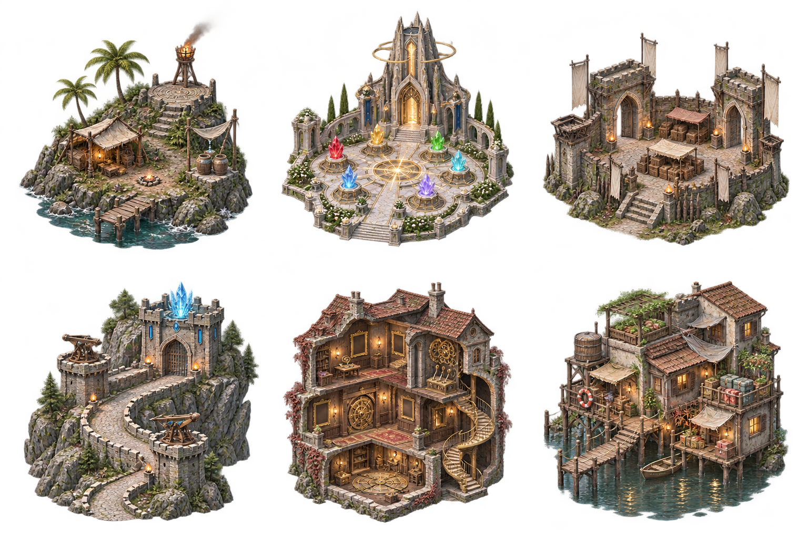

| 格 | 场景名 | 对应题材 |
| --- | --- | --- |
| 01 | 孤岛试炼 | 全球求生 |
| 02 | 觉醒试炼塔 | 全民转职 |
| 03 | 界域竞技城 | 国运争霸 |
| 04 | 山隘防线 | 塔防 |
| 05 | 无声机关馆 | 密室逃脱 |
| 06 | 洪水高台 | 天灾求生 |

### 童话寓言

[fairytale-fables.png](atlases/fairytale-fables.png)

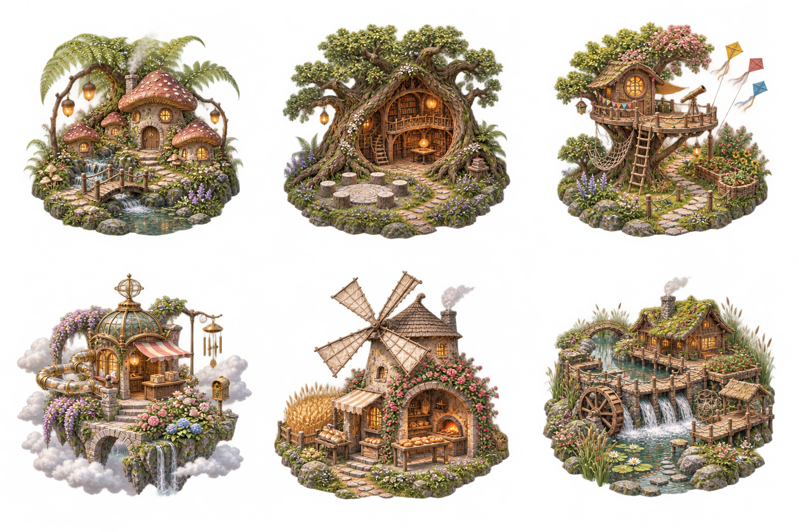

| 格 | 场景名 | 对应题材 |
| --- | --- | --- |
| 01 | 蘑菇灯村 | 童话 |
| 02 | 林间议事树 | 寓言 |
| 03 | 风筝探险营 | 儿童冒险 |
| 04 | 云邮小站 | 轻幻想治愈 |
| 05 | 甜麦烘焙屋 | 美食奇幻 |
| 06 | 河狸水工镇 | 非人/动物主角 |

### 数字虚拟

[digital-worlds.png](atlases/digital-worlds.png)

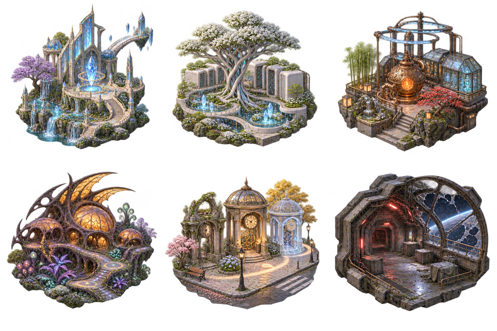

| 格 | 场景名 | 对应题材 |
| --- | --- | --- |
| 01 | 全息主城 | 虚拟网游 |
| 02 | 数据生命庭园 | 数字生命/AI |
| 03 | 量子丹炉 | 赛博修仙 |
| 04 | 生物星巢 | 虫族科幻 |
| 05 | 循环街口 | 时间循环 |
| 06 | 失联轨道舱 | 太空惊悚 |

## 分类与复用

分类原文及素材映射完整保存在 catalog.json：三个 L1 频道、L2 题材、L3 流派、L4 元素，以及受众、篇幅、形式、时代、调性五个独立维度。时代背景不是类型。

同一题材可以覆盖多个频道。百合、纯爱、无 CP 等关系取向不决定建筑或地貌；按故事地点复用场景。甜宠、虐文、BE/HE、年下等叙事标签不单独生成一张固定场景；本批交付主造景，未制作额外天气、灯光、角色或文字叠加层。L3 的系统、快穿、诸天、读档等机制已有对应地标，其余通过题材组合选景。

## 生成记录

prompts/ 保存逐张完整提示词；records/ 保存入口、参考来源、原生尺寸、透明通道、文件大小及 SHA-256。入口为内置 image_gen，工具未披露具体模型版本与画质档位，记录中如实标注未披露；提示词要求最高精度，不把提示词要求当作已核实参数。参考现有世界地图 landmarks.png 的材质与镜头，各题材为新生成原创构图。

PNG 是图集，不是已拆分的单场景文件。后续可依据 catalog.json 中稳定的 scene id、中文名和 frame 直接取用。没有添加游戏脚本或页面。

## 补充查阅与验收

[RESEARCH.md](RESEARCH.md) 记录平台实际读到的分类、未取得正文的来源，以及新增 36 个造景方向。[validation.json](validation.json) 保存文件、透明通道、分类引用与分格检查结果。

图集保留生成原图。少量细枝和薄雾接近等分格线；frame 是等分取样区域，后续拆单张时可按轮廓保留边距。
